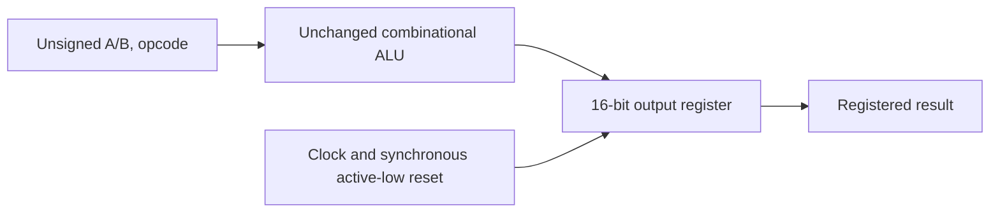

# RTL-to-GDSII Mini ASIC: Physical Design of an 8-bit ALU

**Independent Digital IC Implementation Project**

> **Current status: synthesis-complete.** Exhaustive RTL and functional gate-level
> simulations pass. Nangate45 mapping produces **744 cells / 879.928 µm²**.
> Physical implementation, STA and GDSII are **NOT RUN** because the required
> OpenROAD/Docker environment is unavailable on the audited Mac.

## Overview and motivation

This project connects verified digital logic to standard-cell implementation.
It reuses an eight-operation ALU, adds a precisely defined registered interface,
verifies the interface, and executes real Yosys technology mapping. The next
milestone is the prepared official OpenROAD flow and controlled physical experiments.

The project implements the wrapper, scoreboards, flow configuration, execution
harness and evidence reporting. Established tools perform synthesis and, when
available, physical implementation. It does not implement a new placement or routing engine.

## Relationship to previous work

- [RTL-Verification-Core-ALU](https://github.com/Vinh-Duy/RTL-Verification-Core-ALU)
  supplies the unchanged combinational core and known-answer vectors at commit
  `1621da9b2d9d395698cc23a3dfc3ecf2e66e905d`.
- [EDA_Routing_Algorithm](https://github.com/Vinh-Duy/EDA_Routing_Algorithm)
  explores routing algorithms separately. This project instead integrates an
  established standard-cell implementation toolchain.

Neither earlier repository was modified. [Source provenance](docs/evidence/source-provenance.json)
records exact hashes and reuse boundaries.

## Design architecture



Operations: ADD, SUB, MUL, DIV, AND, OR, XOR and SHL. Addition retains carry,
subtraction wraps modulo 65536, multiplication retains all 16 bits, division by
zero returns zero, and shifts use B[2:0]. Inputs present at a rising edge are
captured at that edge; there are no input registers. See the
[design specification](docs/DESIGN_SPECIFICATION.md).

## RTL-to-GDSII flow

**Executed:** RTL simulation → Yosys/ABC Nangate45 mapping → gate simulation.

**Prepared, NOT RUN:** ORFS synthesis → floorplan → placement → CTS → global routing
→ detailed routing → final timing reports and GDSII read-back.

The project supplies a custom `DESIGN_CONFIG` and isolated `WORK_HOME`; it does not
modify upstream flow scripts. [Flow architecture](docs/FLOW_ARCHITECTURE.md)
describes the implementation and experimental controls.

## Toolchain

Locally verified: Intel x86_64 macOS 13.7.8, Python 3.10.11, Icarus Verilog 13.0,
YoWASP Yosys 0.70 (`28ba3cb92`), Nangate45 typical library at 1.10 V / 25 °C.
Library source: ORFS `7bcaf475c884e15f674e428aa04dbf92bd0426ed`.
No native OpenROAD, Docker, KLayout or standalone OpenSTA is installed.
See [environment and Linux/Docker instructions](docs/ENVIRONMENT.md).

## Functional verification

| Executed local check | Result |
|---|---:|
| Directed/boundary/random RTL suite | 5,280 vectors passed |
| Exhaustive RTL suite + inherited known answers | 524,320 vectors passed |
| Exhaustive mapped gate suite + inherited known answers | 524,320 vectors passed |
| Injected arithmetic/reset/latency/oracle faults | All four rejected |
| Runner, ORFS preflight and metric-parser tests | 14 passed on 27 Oct 2026 |

The exhaustive domain is 524,288 unique binary combinations; the additional
32 vectors are inherited literal known answers. Clock/reset checks are also
performed. Actual waveforms and logs are retained. Gate validation is functional,
zero-delay simulation, **not formal equivalence or timing analysis**.

## Synthesis results

| Nangate45 standalone mapped result | Value |
|---|---:|
| Standard cells | 744 |
| Output registers | 16 |
| Combinational cells | 728 |
| Mapped cell area | 879.928 µm² |

All eight operations, including division, remain present. The area is the sum of
library cell areas, not core/die area. Standalone synthesis does not consume the
physical SDC or prove any clock target. [Evidence and validation](docs/FINAL_VALIDATION.md)
include the warning review and netlist checks.

## Physical design and timing results

Floorplanning, placement, CTS, global/detailed routing, final STA and GDS generation
are **NOT RUN**. There is no WNS, TNS, critical-path delay, routing violation count
or clock-frequency result. The provisional 10 ns SDC target is an assumption,
not a measured 100 MHz capability.

## Experimental comparison and layout visualization

The runner is prepared for fixed-RTL utilization comparisons at 30%, 45%, 60%.
Clock targets must be selected after an actual baseline timing run. No physical
experiment has executed, so no comparative result or physical chart is shown.
No layout screenshot is available because no layout has been generated.

## Repository structure

```text
rtl/                    unchanged ALU and new registered wrapper
tb/                     scoreboard and inherited known answers
constraints/            clock and IO timing assumptions
flow/                   official ORFS custom-design configuration
scripts/                setup, simulation, synthesis, physical and analysis runners
tests/                  execution and metrics tests
experiments/configurations/  planned controlled study parameters
reports/                isolated generated logs, waveforms and netlists (ignored)
docs/evidence/          compact reviewed local result snapshots
docs/                   specification, technical report, limitations and CV summary
.github/workflows/      portable checks; remote execution NOT RUN
```

## Reproduction

Prerequisites: Python 3.10+ and Icarus Verilog with `vvp`. For a compatible platform,
install Icarus using its normal package manager. No system installation is performed
by this repository's setup target.

```bash
make setup                       # project-local pinned Yosys and small library download
make lint test simulate validate exhaustive
make synth gate-exhaustive
make report
```

For the full flow, first prepare the pinned ORFS environment described in
[ENVIRONMENT.md](docs/ENVIRONMENT.md). Run `make physical-preflight` to check the
tools and revision, then `make physical` and `make timing`. Each run gets a unique directory; previous
results survive reruns and `make clean`. A manually triggered
[physical workflow](.github/workflows/physical-baseline.yml) builds the pinned ORFS
container, validates its revision, tools and Nangate45 library, then runs the
baseline before the utilization sweep. The workflow is authored but has **not
been launched**; no hosted physical results are claimed.

## Limitations and future work

This is an honest intermediate implementation checkpoint, not a finished chip.
The immediate next steps are a real ORFS baseline, reviewed timing/routing results,
GDS read-back, and measured physical experiments. Formal equivalence, power analysis,
width scaling and physical sign-off remain future work. No tapeout or silicon claim
is made. Read [LIMITATIONS.md](docs/LIMITATIONS.md), the
[technical report](docs/TECHNICAL_REPORT.md) and the
[admissions/interview summary](docs/PROJECT_SUMMARY.md).
