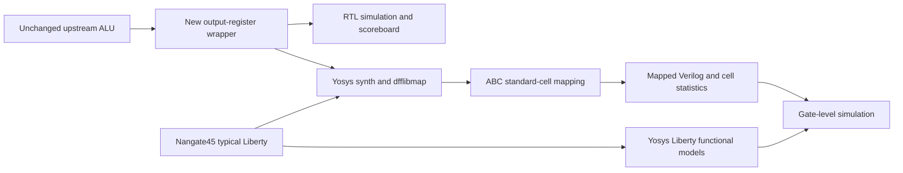

# Flow architecture and reproducibility

## Executed path

Python supplies literal known answers, a boundary cross-product and deterministic
random vectors, or the full known-input domain. A clocked SystemVerilog scoreboard
checks every response plus reset and edge behavior. Expected values are calculated
with Python integers rather than copied RTL expressions. The inherited literal
answers sanity-check the oracle before stimulus is written.

Synthesis lowers arithmetic, including division, flattens the hierarchy, legalizes
and maps flip-flops, maps Boolean logic with ABC, removes debug-only `$scopeinfo`,
and runs `check -assert`. The JSON netlist is checked for non-library internal
cells and exactly 16 output registers. Area comes from `stat -liberty`, not a
floorplan estimate. Standard-cell functional models come from Yosys's Liberty
reader. `-ignore_miss_func` permits unneeded clock-gating cells without usable
functions; none is instantiated by this design. Icarus elaborates the actual
mapped netlist against these generated models. There is no SDF or delay model.

## Prepared physical path — not executed

Official ORFS targets are called in dependency order:

1. `synth`: synthesis and import into OpenDB.
2. `floorplan`: core/die bounds, placement rows, pins, power grid and tie/tap handling.
3. `place`: global and detailed cell placement plus supported optimization.
4. `cts`: clock distribution and legalization.
5. `grt`: coarse routing guides and congestion assessment.
6. `route`: detailed wires/vias, routing checks and filler insertion.
7. `finish`: final reports, netlist, extraction-related outputs and GDS merging.
8. KLayout reads the nonempty GDS and checks the expected `alu_top` top cell.

`flow/config.mk` is passed through `DESIGN_CONFIG`. This project does not copy or
modify ORFS's core scripts. `WORK_HOME` points into a new run directory; ORFS retains
its own `results/nangate45/alu_top/base`, `logs`, `reports` and `objects` organization.
Expected artifact names were checked against the pinned upstream Makefile.

The native backend requires the pinned, clean ORFS checkout. The Docker backend
requires a preinstalled immutable linux/amd64 image and records its digest and
actual tool versions. It sources the official image environment, uses no network
during design runs, and removes its own container on timeout. These backends have
not been end-to-end validated in this host environment.

## Experimental controls

A baseline requests 10 ns, 30% core utilization and placement density 0.70.
These are **provisional inputs**, not measured results. The utilization study
holds target clock and placement density fixed and requests 30%, 45%, 60% core
utilization. Placement density is a global-placement target; it is not an alias
for requested core utilization. A fixed density above the utilization requests
avoids automatically changing two settings in the same sweep; it may require
adjustment after an actual baseline if placement fails.

Clock-sweep values are intentionally empty until real baseline STA can guide the
choice. Select at least three periods around a meaningful feasibility range,
record the rationale, and keep RTL, library, tools, IO budgets and utilization
constant. Target changes may change synthesis and repair decisions, so compare
the final measured implementation rather than assume identical netlists.

Each run has a UTC timestamp plus random unique suffix, immutable outputs, source
content hashes, configuration, command arguments, exit codes and elapsed times.
The suffix only names a directory; it is not a placement seed. Thread count is
recorded but cross-machine bitwise determinism of upstream placement is not promised.
Timeouts terminate the process group and become failures. Missing prerequisites
produce `NOT RUN`. Experiment CSV rows are created only when a flow command
actually executes. Reruns preserve old runs and never consume old result paths.

`collect_metrics.py` retains raw JSON and exact source keys. Missing or changed
metric schemas yield null values. Final setup worst slack is kept separately from
WNS=min(0,worst slack); TNS is read from the tool, not reconstructed. No generic
critical-path-delay number is inferred from clock minus slack: IO delays,
uncertainty and clock latency make that shortcut wrong here. Inspect the expanded
path report to distinguish arrival time from internal data-path delay.

`analyze_results.py` draws requested figures only when successful executed runs
contain measured points. Failed runs remain in CSV/JSON but are excluded from
plots. There are no physical experiment rows or physical plots yet.

## Evidence and limitations

Raw run directories and tools are ignored by Git. Reviewed compact snapshots in
`docs/evidence/` make reported local results available after cloning. The snapshots
are historical records; rerunning writes new reports, not silently new portfolio
claims. `make report` checks RTL freshness and indexes current local reports.
`make clean` only removes Python bytecode and preserves all runs and waveforms.

Portable CI uses Ubuntu packages and logs their versions, so it verifies behavior
but is not the same pinned YoWASP QoR baseline. The workflow was authored here;
its remote execution remains NOT RUN. Full physical CI is intentionally omitted.

The supported `POST_CTS_TCL` hook writes `report_cts` counts in the CTS process.
The runner requires positive roots, inserted buffers, subnets and sinks before
labeling CTS PASS. A copied-through database or skipped tree cannot satisfy this check.
